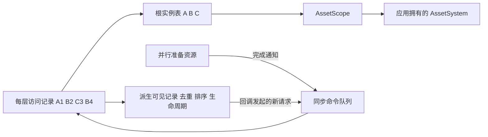

# HaloFrame UI 迁移、导航记录与资源所有权

状态：已采纳，2026-11-02。

## 来源和目标

迁移本机 HaloFrame 的 Runtime/UI 与 Samples/UI，目标为 Assets/GameFramework/Runtime/UI
和 Assets/GameFramework/Samples/UI。示例的 10 个 Prefab 及其 GUID 保留；代码来源作者为
https://github.com/gsm958708323。保留原生命周期命名 OnAwake、OnStart、OnEnable、OnDisable、
OnDestroy；初始化与 Start 每实例一次，显隐可重复，Destroy 与 Release 幂等。

## 导航记录与实例分离

根实例按管理器内的视图类型唯一；子界面按父实例内的类型唯一。每次 Open 都返回独立
UIHandle，保存访问 ID、参数、打开/关闭完成通知。A-B-C-B 只有三份根实例，返回顺序为
C-B-A。Close(handle) 只移除这次访问，Pop 在命令执行时选择本层最后一条记录，包括加载中
的请求；连续两次 Pop 移除两条记录。只有最后一条引用消失时才释放共享实例。

每层只有一份条目列表，同时包含加载中与已提交记录。不同实例可并行加载，同层按请求
顺序提交；共享实例的准备任务也唯一。取消一条记录不能取消其他记录仍需要的实例。
资源失败移除该实例相关的等待记录；旧界面保持可用。提交不等待资源，生命周期回调中
的新导航命令延后到当前轮状态/显隐更新结束，避免递归修改导航集合。

本层最新全屏及其上方弹窗可见。同一实例若出现在多条可见记录中，只在最新位置绘制。
CloseSelf 关闭实例当前激活的访问；Close<T> 明确关闭最后一条该类型记录。未显示的历史
记录不单独触发生命周期。OnStart 一次；Arguments 随当前访问切换。参数数组复制，但
参数对象须由调用者提供不可变数据。CaptureNavigationState/RestoreNavigationState 是
可选状态快照扩展，用于分别保留每次访问的表单/滚动状态，不替代既有生命周期。

## 资源边界与配置

UIManager 直接使用注入的 AssetSystem.CreateScope，动态视图与独立地址 Item 直接使用
AssetScope.InstantiateAsync，没有资源桥接脚本。应用负责 Tick 和最终 ShutdownAsync，
先 Dispose UIManager。隐藏不归还资源。AssetScope 负责实例的延迟销毁与依赖释放顺序。

静态子视图使用配置中的明确相对 NodePath，借用父 Prefab 节点，不重新挂载或单独销毁。
模板 Item 必须位于父视图资产中，先销毁克隆再释放父依赖；独立资产使用 CreateItemAsync。
父级释放逐项清理子界面/Item，某个业务清理回调抛异常也继续释放其余对象。

删除 ResId、ResConfigSO 和静态配置缓存；PrefabAddress 就是 AssetManifest 地址。配置为
原生 Unity SO 列表，不依赖 Odin、GameManager、ResourceManager、AssemblyTools。进入运行时
前校验类型、构造函数、地址、层、子树环、静态路径与重叠借用，再映射为只读定义。
类型名包含程序集，反射构造需保留；示例使用 Preserve，不进行运行时程序集扫描。

子界面开关属于父界面的选择，不加入根导航历史；准备成功才切换选择。父界面隐藏保留
选择，恢复时恢复选中的子界面。Hide 复用，Remove 才释放。动态/静态模式由父绑定配置，
不能在实例已加载后随请求改变资源所有权。

## 排序、隐藏与性能边界

按层顺序和可见视图树集中紧凑分配 sortingOrder，计入嵌套 Canvas、Item 和选中子界面，
静态子树由自己的视图排序。移除 100/10 固定步长和 10/9 数量限制，只校验 Unity 实际
sortingOrder 范围。每个视图保留自有 Canvas 的局部先后关系。

2D 层使用 ScreenSpaceOverlay，不修改应用世界相机；SceneLayer 保留 WorldSpace Canvas。
默认 1920x1080、Expand。仅在应用没有 EventSystem 时创建，优先使用项目的 Input System。

隐藏不调用根 GameObject.SetActive(false)，同时关闭自有 Canvas、GraphicRaycaster、Animator，
保存原启用状态并在恢复时还原。VisibilityToken 在隐藏时取消，业务可用它停止仅在可见期间
需要的任务；Lifetime 用于实例生存期。静态子树由子控制器管理，防止父级覆盖其局部状态。
旗标数组复用，显隐无变化时不重复执行回调；只在导航/子视图变更时更新，无逐帧轮询 UI 栈。

不增加动画系统、对象池、热更新或代码生成器。CanvasRebuildListener 只作可选示例诊断，
默认不挂载。移动设备、IL2CPP 和业务资源性能需要相应平台验收，不能由编辑器测试替代。
