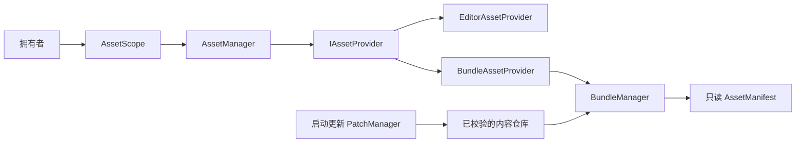

# GameFramework Asset 资源管理框架

本项目基于提供的自研 AssetBundle 设计文档，在 Unity 6000.0.32f1 中实现资源管理框架。
运行时支持按地址加载、叠加场景加载、请求合并、独立取消、拥有者作用域、实例转移、
依赖引用计数、启动时内容更新和持有关系诊断。UniTask 固定使用 2.5.11 版本。



运行时、通用编辑器工具、示例运行时和示例编辑器工具分别位于独立程序集。
业务代码通过作用域使用资源；管理器和租约均为内部实现。

## 运行演示

1. 使用 Unity 打开本项目，等待 Package Manager 解析并安装依赖。
2. 如果缺少示例资源，执行 `Game Framework > Assets > Create Demo Content`。
3. 执行 `Game Framework > Assets > Stage Demo For Player`，为当前目标平台构建真实资源包，并将发布内容放入 StreamingAssets。
4. 打开 `Assets/Scenes/AssetLifecycleLab.unity` 并进入 Play Mode。在启动组件的 Inspector 中选择 Editor 或 Bundle 模式；独立运行程序始终使用 Bundle 模式。
5. 使用 `Game Framework > Assets > Debugger` 查看资源地址、拥有者和资源包状态。

主城面板和战斗面板共享 `ui_common`；战斗场景与 HUD 共享 `hero_001`。
返回主城时，系统释放战斗作用域，保留主城仍在使用的材质。
加载过程中返回，只取消该作用域的等待，不影响其他作用域。

## 接入方式

```csharp
var manifest = AssetManifest.FromJson(manifestJson);
var system = AssetSystem.Initialize(AssetSystemMode.Bundle, manifest, paths);
driver.Bind(system);
var scope = system.CreateScope("Battle");
var hero = await scope.InstantiateAsync("Hero/Hero001_Hud", parent, ct);
var scene = await scope.LoadSceneAsync("Scene/Battle_01", ct);
scope.Dispose();
// 需要等待系统彻底释放时：
await system.ShutdownAsync();
```

作用域还提供 `LoadAsync<T>`、`Release`、`ReleaseScene`、`ReleaseInstance`、
`TransferInstance` 和 `CreateChild`。需要提前释放实例时，应通过所属作用域销毁实例。
允许直接调用 `Object.Destroy`，但其租约会保留到作用域释放时。
所有运行时操作必须在 Unity 主线程执行。保持启动场景处于加载状态，
并让每个作用域的存活时间与其真实拥有者一致。

## 构建与更新

创建 `AssetBuildProfile`，配置唯一资源地址、小写资源包名称及主资源引用。
选中该配置并执行 `Build Selected Profile`。构建结果输出到已被 Git 忽略的
`Build/AssetContent` 目录，包括 `bundles/<sha256>.bundle`、
`manifests/<sha256>.json`、`version.json` 以及便于阅读的 `asset_manifest.json`。
场景资源与普通资源必须分别打包。共享资源必须显式配置为条目，避免被隐式重复打包。

将 `version.json`、`manifests/` 和 `bundles/` 部署在同一个发布根目录下。
在启动组件中配置 Remote Root，即可在启动时更新；留空则安装随程序打包的内容。
随包文件通过 `UnityWebRequest` 复制，也支持读取 Android APK 内的 StreamingAssets。
只有已安装版本通过完整校验后，才允许离线进入。更新失败不会激活不完整版本。
发布内容发生变化时，必须递增版本号。

## 验证方式

运行 Test Runner 前，先构建并准备示例内容，然后分别运行
`GameFramework.Asset.EditModeTests` 和 `GameFramework.Asset.PlayModeTests`。
测试覆盖 Manifest 校验、循环依赖、独立取消、失败重试、同帧复用、实例转移、
跨线程误用、真实资源包共享、叠加场景卸载、损坏依赖回滚、HTTP 更新、
完整性校验失败、更新取消、已发布版本不可变及本地修复。

执行 `Game Framework > Assets > Build Windows Demo Player`，可在 `Build/Player`
中构建独立的开发版运行程序。启动时传入 `--asset-smoke-result <absolute-json-path>`，
程序会自动安装随包内容、进入战斗、返回主城、检查材质、释放全部资源，
并输出机器可读的结果后退出。正常交互运行无需传入该参数。

Windows 编辑器测试不能证明 Android/iOS 真机行为。应为每个目标平台构建并准备内容，
再在实际设备上验证加载、切入后台与恢复、存储和内存表现。
本框架按约定不包含同步加载、子资源、LRU、加密、断点续传和按需更新。

架构与关键生命周期决策记录在 `Docs/adr/0001-asset-lifetime-and-content-activation.md`。
需求覆盖、实测结果和待完成的真机检查记录在 `Docs/verification/2026-10-31-asset-framework.md`。
