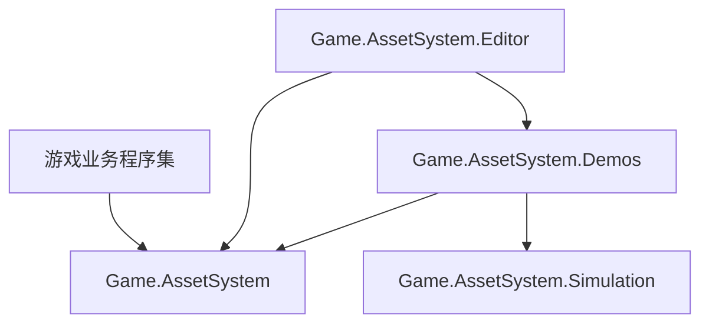
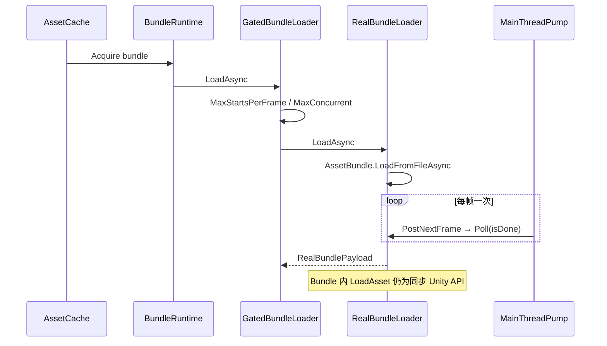

# AssetSystem

Unity 侧可热更内容的运行时框架：**扫描 / 构建在 Editor，客户端负责补丁下载 → 激活版本 → Bundle 引用计数 → 资产 Handle/Scope → 内存回收 → 发布期门禁**。

纯逻辑库：没有可渲染内容、没有场景依赖、没有第三方运行时依赖。证据在 Console、HUD 和测试断言里。

| 项 | 值 |
|---|---|
| Unity | `6000.0.32f1`（URP 17.0.3） |
| 程序集 | 6 个 asmdef；`Runtime` 78 个 `.cs` |
| 测试 | EditMode 7 + PlayMode 31，全部通过 |

## 定位与设计原则

| 原则 | 含义 |
|---|---|
| Runtime 是唯一真相源 | 业务与测试只引用 `Game.AssetSystem`，不引用 `Game.AssetSystem.Demos` |
| Demo 只做演示 | 只保留 **Lessons（分课控制台）** 与 **FullFeature（全功能交互）** 两个 Play 场景 |
| 对外单一入口 | 其它系统通过 **`AssetSystemHost` + `AssetSystemFacade`** 接入，不复制 Demo 编排 |
| 真实 Bundle 异步加载 | `LoadFromFileAsync` 分帧完成，配合 `AssetLoadGate` 分帧启动，消除单帧 `LoadFromFile` 尖刺 |

## 目录结构

```
Assets/Game/AssetSystem/
├─ Runtime/                             asmdef: Game.AssetSystem
│  ├─ Core/                             MainThreadPump（优先级 + 预算）、PumpBudget、主线程任务契约
│  ├─ Loading/                          可取消加载、SharedLoadRegistry（同 key 合并）
│  ├─ Scheduling/                       优先级与双预算调度、LoadScope
│  ├─ Storage/                          文件事务、Hash、Patch 暂存、路径安全、启动恢复
│  ├─ Patch/                            唯一清单、IPatchTransport、Apply、PatchActivationService
│  ├─ Bundles/                          BundleRuntime、IBundleLoader、引用计数与依赖租约
│  ├─ Assets/                           AssetCache、AssetKey / Handle / Scope
│  ├─ Memory/                           AssetMemoryPolicy + Evaluator（先 Asset 后 Bundle）
│  ├─ Diagnostics/                      运行时快照（只读）
│  ├─ Content/                          ActiveContentContext、BuildManifestReader
│  ├─ Release/                          AssetLoadGate、SafePointGate、RealBundleLoader（异步）
│  ├─ Hosting/                          AssetSystemOptions / Facade / Host / ActiveContentState
│  ├─ Integration/                      FullChainRunner / FullChainLayout / DemoGraphNode（测试与 Editor 用）
│  ├─ Simulation/                       asmdef: Game.AssetSystem.Simulation（唯一一套替身）
│  └─ Demos/                            asmdef: Game.AssetSystem.Demos（场景入口，业务禁止引用）
│     ├─ Lessons/  FullFeature/  Shared/  Diagnostics/
├─ Editor/                              asmdef: Game.AssetSystem.Editor（扫描 / Manifest / AB 构建 / 窗口）
├─ Tests/                               EditMode 7 / PlayMode 31
└─ Lesson41Sample/ Lesson42Sample/ Lesson43Sample/ FullFeatureSample/   示例资源（非代码）
```

**Build Settings 中的 Demo 场景只有两条：** `Demo_Lessons.unity`、`Demo_FullFeature.unity`。

## 程序集边界



- **业务代码**：只依赖 `Game.AssetSystem`（`autoReferenced`）。
- **Demos**：可引用 Simulation；业务不得引用 Demos。
- **测试**：PlayMode 依赖 Runtime + Demos + Simulation；EditMode 依赖 Runtime + Demos + Editor。
- 方向单向（`Runtime ← Simulation ← Demos ← Editor`）：Runtime 反向引用 Demo 或替身会**编译失败**，不靠人盯。

## Runtime 分层职责

| 层 | namespace | 职责 |
|---|---|---|
| Core | `Game.AssetSystem.Core` | 主线程泵、优先级队列、跨线程 Post |
| Loading / Scheduling | `Loading`, `Scheduling` | 可取消加载、共享合并、优先级与预算 |
| Storage / Patch | `Storage`, `Patch` | 磁盘布局、断点续传、apply、激活校验 |
| Content | `Content` | 激活后 manifest → Bundle/Asset 目录 |
| Bundles / Assets | `Bundles`, `Assets` | Bundle 引用与依赖租约；按 Key 加载、Scope 生命周期 |
| Memory | `Memory` | 压力等级下的批量卸载顺序（Medium/High/Critical → 2/6/64 次每帧） |
| Release | `Release` | 每帧启动数 / 并发数、安全点、真实 Bundle 异步加载 |
| Hosting | `Game.AssetSystem.Hosting` | **对外门面**：初始化、Tick、加载、下载、激活、重建运行时 |
| Integration | `Game.AssetSystem.FullChain` | 全链路 Runner + 布局常量，供测试与 Editor，不是玩家 Demo |

高级场景仍可直接注入自定义 `IBundleLoader` 的 `BundleRuntime`；日常业务走门面。

## 对外接入

场景挂 `AssetSystemHost`（`Runtime/Hosting/`），Inspector 填客户端目录、首装来源与加载预算即可：

| 阶段 | 行为 |
|---|---|
| Awake | `MainThreadPump.EnsureExists()`，构造 `AssetSystemFacade` |
| Start | `await facade.InitializeAsync()` — 恢复 `state/active.json`，或首装基础版本并激活、重建运行时 |
| Update | `facade.Tick()` — 启动排队加载 + 按内存压力回收 |
| 加载 | `CreateScope` → `LoadAsync<T>(key, scope)` → Scope Dispose 释放引用 |
| 换版本 | `DownloadAndStageAsync(..., IPatchTransport)` → 安全点内 `ActivateAsync` → 自动重建运行时 |

不想挂组件就自己持有门面：

```csharp
using System.IO;
using Game.AssetSystem.Hosting;
using Game.AssetSystem.Assets;

var facade = new AssetSystemFacade(new AssetSystemOptions
{
    ClientRoot      = Path.Combine(Application.persistentDataPath, "Content"),
    BaseContentRoot = cdnRoot,              // 已有 active.json 时可留空
    PlatformKey     = PlatformKeys.Current,
    BaseVersion     = "v1"
});

await facade.InitializeAsync();

using (var scope = facade.CreateScope("MainMenu"))
{
    var result = await facade.LoadAsync<YourAsset>("ui/shop/shoproot", scope);
    // result.Status == AssetLoadStatus.Succeeded → result.Value
}
```

门面 API：`InitializeAsync` / `Tick` / `CreateScope` / `LoadAsync<T>` / `ReleaseAllScopes` / `DownloadAndStageAsync` / `ActivateAsync` / `RebuildRuntime` / `SetMemoryPressure`，只读 `ActiveVersion` / `Ready` / `GatePendingCount` / `Diagnostics`。

下载传输由 `IPatchTransport` 注入：生产用真实 HTTP/CDN，FullFeature Demo 用 `SimulatedCdnServer`。
`FullFeatureSession` 只是 Demo 薄壳（路径 + 日志 + 模拟 CDN），内部持有同一个门面。

## 真实 Bundle 异步加载

两层节流：**Gate 控制每帧启动几个**，**`LoadFromFileAsync` 控制每个多久完成**。



- 轮询用 `MainThreadPump.PostNextFrame`：在 pump 动作里再 `Post` 会被同一帧重新取到，空转到动作上限。
- 取消：Unity 没有取消接口，调用方立即拿到 canceled；轮询继续到 `isDone` 后把无人认领的 Bundle `Unload(true)`，不泄漏文件映射。
- Lessons（如 L44）仍可用 `SimulatedBundleLoader`；FullFeature、FullChain 与生产路径统一 **Real + Gate**。

## Demo 分工

| 场景 | 受众 | 内容 |
|---|---|---|
| `Demo_Lessons` | 学习 / 单模块回归 | Inspector 选 `LessonDemoKind`，控制台跑 3.1–3.6 / 4.4–4.7 / 5.1 / 5.2 |
| `Demo_FullFeature` | 集成验收 / 试玩 | 三版本、断点续传、激活与安全点、共享 Bundle、内存分级回收；HUD 默认隐藏，`F1` 唤出 |

Interactive 演示与 FullChain 独立场景已删除：前者与 FullFeature 职责重叠，后者是断言问题而非演示问题
（Runner 保留在 `Runtime/Integration/`，由 PlayMode 用例驱动）。

## 构建与运行

| 菜单 | 作用 |
|---|---|
| `Tools/Game Asset System/Build Full-Chain Demo Content` | 扫描 → 依赖图 → 构建 `fullchain-v1/v2` 真实 Bundle |
| `Tools/Game Asset System/Build Full-Feature Demo Content` | 构建 `v1/v2/v3` 三套内容（`ui_shop`/`battle_fx` 依赖 `shared`） |
| `Tools/Game Asset System/Build Content And Play Demo` | 构建全链路内容后自动进 Play |
| `Tools/Game Asset System/Build Full-Feature Content And Play` | 构建全功能内容后自动进 Play |
| `Tools/Game Asset System/Inspect/…` | 扫描分组 / 依赖图与 Manifest / Bundle 构建校验 |
| `Tools/Game Asset System/Clean …` | 清理对应产物 |

产物在工程根 `GameAssetSystemBuild/`（本仓库随代码提交，保证 clone 后 PlayMode 用例不缺内容）。

跑测试：`Window > General > Test Runner` → EditMode / PlayMode → Run All。

**排错三条**

- 报 `referenced script is missing`：Bundle 记录的是程序集名，改过 asmdef 或挪过类型后必须重跑两个 `Build … Demo Content`。
- 激活一直 `RejectedActiveHandles`：还有活动 Handle 或在飞加载，先 `ReleaseAllScopes()`。
- 激活一直 `RejectedUnsafePoint`：`SafePointGate` 没进入，先 `facade.SafePoint.Enter("MainMenu")`。

## 更多

落地过程、逐课对照、测试清单、三轮收敛与代码审查记录：[`Docs/AssetSystem-落地与测试报告.md`](Docs/AssetSystem-落地与测试报告.md)。
